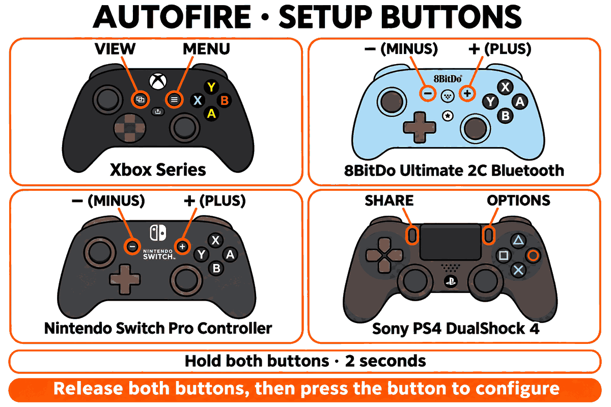

# PicoBluetoothJoystic

PicoBluetoothJoystic turns a Raspberry Pi Pico W into a two-player Bluetooth-to-USB gamepad bridge for Windows. It accepts one Xbox Series controller over BLE and one Bluetooth Classic HID alternative (8BitDo Ultimate 2C, Switch Pro, or experimental DualShock 4), normalizes their inputs, and exposes two independent XUSB/XInput-compatible USB slots.

> This is an independent community project. It is not affiliated with, endorsed by, or certified by Microsoft, Nintendo, Raspberry Pi, or 8BitDo. It is a PC adapter, not an Xbox-console accessory.



The image is an instructional illustration, not an official product photograph.

## Confirmed hardware and scope

- Raspberry Pi Pico W (RP2040 + CYW43439).
- A USB data cable; charge-only cables do not work.
- Xbox Wireless Controller model 1914, firmware 5.9.2709.0, over BLE.
- 8BitDo Ultimate 2C Bluetooth Controller, Switch profile, over Classic HID.
- Nintendo Switch Pro Controller over Classic HID is a functioning alternative, as previously confirmed by the user; this DS4 stage does not claim two simultaneous Classic controllers.
- Sony DualShock 4 over Classic HID is an experimental profile. The user reports that its controls and AUTOFIRE worked in The Occultist; exact DS4 revision and Xbox + DS4 simultaneous operation were not established by that test.
- Windows 11 using two XUSB/XInput-compatible interfaces.

The user confirmed Xbox, 8BitDo and Switch Pro as functioning controller alternatives and physically validated Xbox + 8BitDo operation, reconnection and persistent Bluetooth links, lowest-free-slot assignment, independent slot release, the 8BitDo player indicator, per-controller AUTOFIRE, and the read-only USB guide volume. The user also reports DS4 controls and AUTOFIRE working in The Occultist. The DS4 sticks still show small movement in `joy.cpl`; the supplied XInput capture does not include raw Bluetooth reports. Xbox + DS4 simultaneous operation has not been reported as tested. No claim is made for two Xbox controllers, more than two players, Xbox consoles, rumble forwarding, or wireless audio.

## Bluetooth limits: which two controllers can connect?

There are two USB XInput outputs, but the Pico currently has only **one BLE controller connection** and **one Bluetooth Classic HID connection**. The Classic HID host accepts one active Classic controller total. Use up to one Xbox Series controller over BLE plus one Classic controller (8BitDo, Switch Pro, or experimental DS4). The Xbox + DS4 combination is the goal of this stage and still needs a physical test.

| Combination | Status |
| --- | --- |
| Xbox + 8BitDo | Previously physically validated |
| Xbox + Switch Pro | The transports permit this pairing; this stage does not repeat its physical validation |
| DS4 alone in The Occultist | User reports controls and AUTOFIRE work; small `joy.cpl` stick movement remains |
| Xbox + DS4 | Not validated by the reported game test |
| 8BitDo + Switch Pro | Not simultaneous: both need the single Classic connection |
| DS4 + 8BitDo, DS4 + Switch Pro, or two DS4 | Not simultaneous in this stage |

For a Classic-to-Classic change, turn off/disconnect the current Classic controller before powering on or pairing the replacement. The second XInput output stays neutral if unused. Two XInput slots do not mean two Classic radios/connections.

### Remembered bonds, active links and USB outputs

These limits are separate:

| Resource | Capacity | Meaning |
| --- | --- | --- |
| Remembered Classic identities | 4 | Four bonded Classic controllers can be retained for later use, including controllers that are powered off. |
| BTstack Classic key records | 5 | Four committed bonds plus one provisional key slot used only while a replacement is validated. |
| Active Classic HID connections | 1 | Only one 8BitDo, Switch Pro or DS4 can be connected at a time. |
| Active BLE/HOGP connections | 1 | Used by the supported Xbox Series 1914. |
| USB XInput outputs | 2 fixed slots | The outputs remain enumerated; an unused output is neutral. |

If there is free remembered capacity, pair a supported Classic controller normally. At full capacity, the Pico will not evict a bond based on an advertisement or name. Disconnect the active Classic controller, load `firmware\pico_ds4_cdc_diagnostic.uf2`, open its COM port at 115200 baud, send `BOND LIST`, then send `BOND PAIR` and put the new controller into Pair mode within 60 seconds. The diagnostic build has a single generic HID output, not the production dual-XInput USB layout; switch off the Xbox during this maintenance pairing if that output is occupied, then load the XInput candidate again.

The Pico stages the candidate key while preserving the old bond. It chooses the least recently used disconnected identity that is not reserved by an active connection or authentication. Replacement commits only after a supported profile produces a valid controls report (`INPUT_READY`). Failed attempts roll back and keep the old key. Use `BOND REMOVE AA:BB:CC:DD:EE:FF` with an address printed by `BOND LIST` to intentionally remove only that Classic bond and its RAM AUTOFIRE settings; other Classic bonds and the Xbox BLE bond remain. The LRU order is updated at `INPUT_READY`, not on every report. A power loss during a provisional attempt recovers by rolling it back; a power loss after commit intent completes the validated replacement.

## Player slots

The two USB outputs remain enumerated. The first controller to reach a valid input-ready state receives the lowest free logical slot. Disconnecting it immediately neutralizes and releases only that slot; the other player is not moved. A reconnecting controller again receives the lowest free slot. Bluetooth identities and keys persist, but player numbers do not.

Windows may assign different global XInput indexes when other controllers are installed. A Pico logical slot is not guaranteed to be global XInput index 0 or 1.

## Install with BOOTSEL

1. Disconnect the Pico W.
2. Hold **BOOTSEL**, connect the USB data cable, and release the button when `RPI-RP2` appears.
3. From PowerShell, explicitly select the desired image:

```powershell
.\Load_Firmware.bat firmware\pico_xinput_dual_ds4_candidate.uf2
```

The loader prints the path and SHA-256 before copying. If the application fails, repeat BOOTSEL; the ROM bootloader remains available.

The development build uses USB identity `VID:PID 2E8A:000A`. PID `000A` is allocated to Raspberry Pi Pico SDK CDC UART and is not assigned to this project. Obtain an appropriate PID before distributing a production binary; see [USB identity and XInput](docs/xinput.md).

## Pairing and reconnection

For Xbox, hold its pairing button until the logo flashes rapidly. For 8BitDo, select Switch Bluetooth mode, turn it on with Home, and hold Pair for approximately three seconds. Pairing is normally required only once. Link data is stored in Pico W flash; ordinary disconnects do not erase it.

The 8BitDo uses Bluetooth Classic HID and the observed `0x3F` report format. DS4 is selected using a Sony HID descriptor signature and validated report ID/length, not name alone. Its `0x01` basic input and `0x11` full Bluetooth report are supported in the candidate; full reports use CRC32. The optional feature request does not gate controls. Lightbar output, PS/touchpad, motion, audio and rumble are not implemented. First pairing uses SHARE + PS; reconnect with PS only. AUTOFIRE setup uses SHARE + OPTIONS. The PC sees only the Pico's XInput-compatible USB outputs, not original Bluetooth profiles.

## AUTOFIRE

Settings are independent per controller and target. They remain in RAM across a Bluetooth reconnection and are cleared when the Pico W restarts. Bluetooth bonds remain persistent.

1. Hold Xbox **View + Menu**, 8BitDo/Switch Pro **Minus + Plus**, or PS4 DualShock 4 **SHARE + OPTIONS** for two seconds. On the DS4, **SHARE + PS** is for first-time Bluetooth pairing, not AUTOFIRE setup.
2. Wait for three rapid Pico LED flashes and release both buttons.
3. Press one target: A/B/X/Y, LB/RB (L/R), LT/RT (ZL/ZR), L3, or R3.
4. With no D-pad direction, an unconfigured target is enabled at 10 presses/s and a configured target is disabled.
5. Hold one cardinal direction while selecting: Up 5, Right 10, Down 15, Left 20 presses/s.

The selection is consumed. Diagonals and multiple targets are rejected. Setup times out after ten seconds. AUTOFIRE operates only while the physical target is held. Trigger activation uses 50% with release hysteresis at 45%.

LED feedback: three rapid flashes for setup armed, two short for enabled, one long for disabled, one to four flashes for 5/10/15/20 Hz, and four rapid flashes for cancel/timeout. One shared Pico LED cannot identify which controller requested feedback.

## Read-only `PICO_GUIDE`

The final build adds a static FAT12 USB drive containing `README.TXT`, `MANUAL.HTM`, `AUTOFIRE.PNG`, and `VERSION.TXT`. It is served from immutable flash, advertises write protection, and rejects write/format SCSI commands with DATA PROTECT. It is not the `RPI-RP2` BOOTSEL drive and exposes no Bluetooth keys or firmware storage.

## Reproducible build

Pinned dependencies and checksums are listed in [DEPENDENCIES.md](DEPENDENCIES.md). On Windows:

```powershell
.\setup-deps.ps1
.\test-host.bat
.\build-autofire-guide.bat
```

`build-dualshock4-xinput.bat` builds the stage 1 candidate for `pico_w` and writes `firmware\pico_xinput_dual_ds4_candidate.uf2`. The user reports DS4 controls and AUTOFIRE working in The Occultist; Xbox + DS4 simultaneous operation and the exact DS4 revision remain unvalidated. The diagnostic script creates a separate CDC + generic HID UF2. Any change to embedded guide files changes the XInput UF2 and SHA-256; the latest guide-image rebuild has not itself been retested physically.

## Diagnostics and validation

- `tools/check-xinput.ps1` lists XInput indexes and changes.
- `tools/measure-autofire.ps1` reports its polling cadence and is fast enough to inspect 20 Hz transitions. It is not an end-to-end latency measurement.
- UART0 GPIO0/GPIO1 at 115200 baud remains an optional 3.3 V diagnostic path.
- [Validation guide](docs/validation.md)
- [Known limitations](docs/limitations.md)
- [Architecture](docs/architecture.md)
- [DualShock 4 stage 1 guide and capture procedure](docs/dualshock4.md)

The host suite covers parsers (including synthetic DS4 0x01/0x11 fixtures), routing and identity-bound AUTOFIRE, XInput serialization, reconnection, read-only FAT/MSC, embedded assets, and dual-XUSB-plus-MSC descriptors. The user separately reports successful DS4 controls and AUTOFIRE in The Occultist; this does not validate Xbox + DS4 simultaneous operation or replace hardware testing of a rebuilt UF2.

## Licensing and provenance

Project-authored source is under the [MIT License](LICENSE). Dependencies retain their own licences and restrictions. Review [THIRD_PARTY_NOTICES.md](THIRD_PARTY_NOTICES.md), [REFERENCES.md](REFERENCES.md), and [LICENSES](LICENSES/) before redistributing binaries. References do not imply copied code, and a URL alone is not a reuse licence.

## Layout

- `src/bluetooth`: BLE and Classic transports and reconnection.
- `src/controllers`: HID, Switch-compatible, Classic profile identification, and DS4 candidate parsers.
- `src/core`: normalized state, routing, and AUTOFIRE.
- `src/usb`: HID, dual XUSB, and read-only guide MSC.
- `src/led`: non-blocking LED arbitration.
- `tests`: host regression tests.
- `assets/guide`: files embedded in `PICO_GUIDE`.
- `docs`: architecture, research, diagnostics, and phase records.
